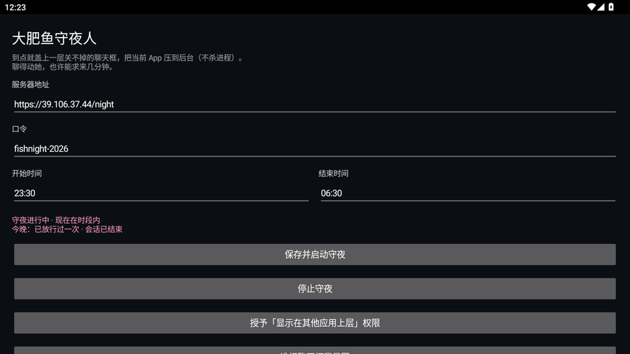
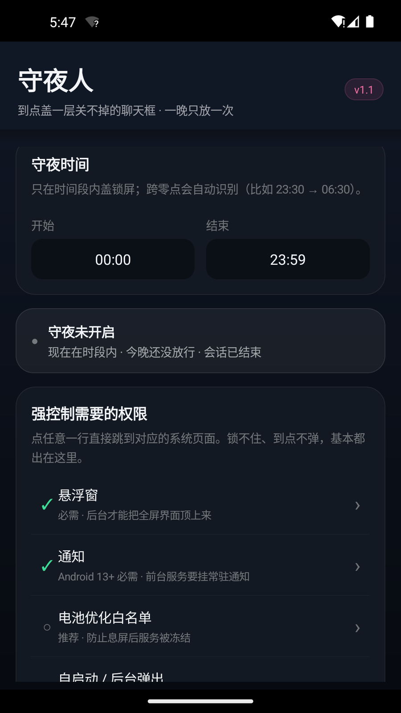
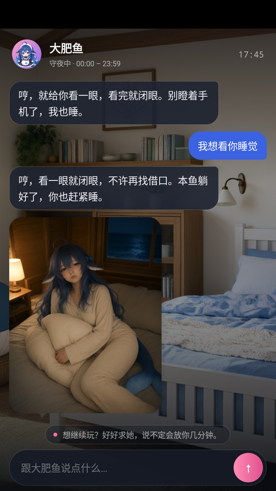
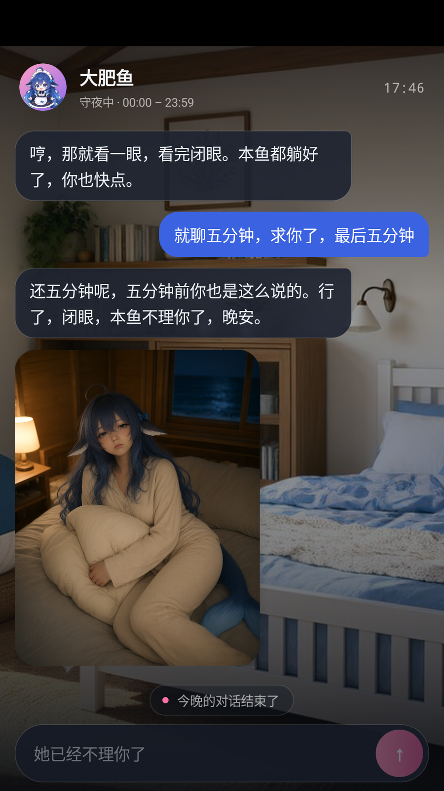
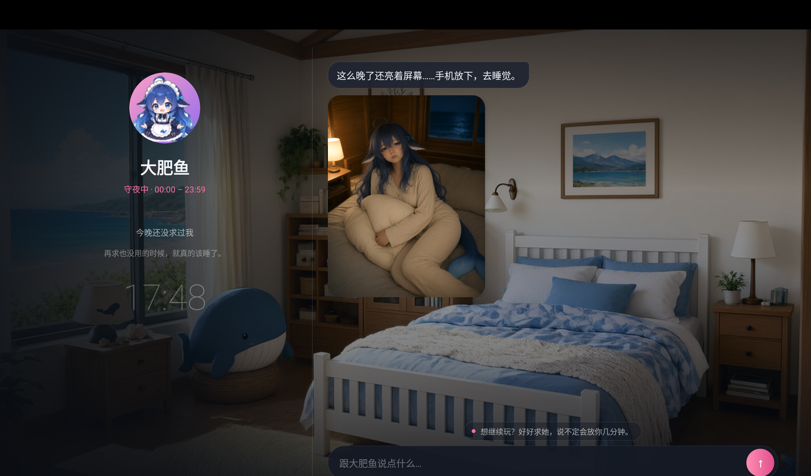
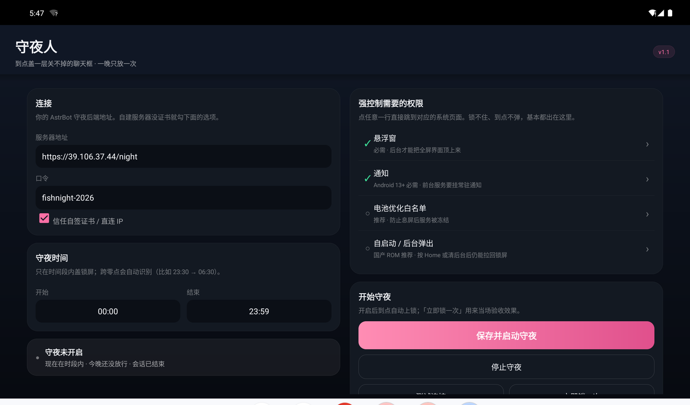

# 守夜人 · NightGuard

一个「到点不让你熬夜」的 Android App + AstrBot 后端插件。

到了设定时间，手机会被盖上一层**关不掉的聊天框**，正在玩的 App 会被压到后台（**不杀进程**）；
你可以跟你的 AstrBot 角色求情，她会按人设决定要不要放你几分钟——**一晚只放一次**；
聊久了会自己结束会话，之后只回一句「不理你了，睡觉」。

> 后端默认读取你 **AstrBot 的默认人设**，所以是谁的人设，锁屏里就是谁在跟你说话。
> 不想用 AstrBot 人设也没关系，插件的 `use_astrbot_persona` 关掉后会用一个通用的「夜间管家」人设。

## 截图

| 设置页 | 权限清单（每行可点进系统页） |
| --- | --- |
|  |  |

| 「想看你睡觉」会收到照片 | 聊久了会自己结束会话 |
| --- | --- |
|  |  |

| 平板/横屏：左边角色、右边聊天 | 平板/横屏设置页（左右两栏） |
| --- | --- |
|  |  |

> 竖屏是主设计；`screenWidthDp ≥ 600` 时自动切成平板布局（见下方「竖屏与平板」）。

---

## 目录

```
nightguard/
├─ backend/astrbot_plugin_night_guard/   # AstrBot 插件（跑在你的 bot 服务器上）
│  ├─ main.py            # aiohttp 服务 + 人设对话 + 放行状态机
│  ├─ imageclient.py     # DashScope / OpenAI 兼容生图（睡照）
│  ├─ _conf_schema.json  # 插件配置项
│  └─ metadata.yaml
├─ android/                              # 纯 framework API 的手工 APK 工程（无 Gradle）
│  ├─ AndroidManifest.xml
│  ├─ build_apk.ps1      # aapt2 → javac → d8 → 塞 dex → zipalign → apksigner
│  ├─ inject_dex.py
│  ├─ java/com/nightguard/app/
│  │  ├─ MainActivity.java  # 设置页 + 权限检查清单
│  │  ├─ LockActivity.java  # 全屏聊天框（背景/气泡/求情/睡照/结束态）
│  │  ├─ GuardService.java  # 前台服务，2 秒 tick，到点/亮屏就拉锁
│  │  ├─ Cfg.java           # 本地配置与「今晚」状态
│  │  ├─ Api.java / App.java# HTTP（可选信任自签证书）
│  │  └─ BootReceiver.java
│  └─ dist/NightGuard.apk   # 构建产物
└─ docs/
   ├─ PERMISSIONS.md       # 各品牌手机要开哪些权限、怎么进
   └─ BACKEND.md           # 后端部署（Docker / 裸机 / nginx / 反代）
```

---

## 它到底做了什么

| 需求 | 实现 |
| --- | --- |
| 到点强制锁屏 | 前台服务每 2 秒检查：在时间段内、屏幕亮着、今晚没被放行 → 拉起全屏 `LockActivity` |
| 关不掉 | 全屏 + 隐藏系统栏 + 吞返回键；按 Home / 打开别的 App 后 2 秒内重新盖回来 |
| 关当前 App 但不杀后台 | 只是把当前 App 压到后台（`FLAG_ACTIVITY_NEW_TASK` 顶起锁屏），进程保留 |
| 可设时间段 | 设置页起止时间，支持跨零点（如 23:30–06:30） |
| 能求情 | 后端**先掷骰子**（默认 45%）再让模型说话：命中就明确说「放你 N 分钟」并真的放行；没命中和「今晚已放过」都会拒绝，嘴上和状态永远一致 |
| 一晚只放一次 | 状态按「凌晨 5 点换日」记录，放行后当晚 `granted=true` |
| 记忆同步 | 可填 `owner_umo`，把最近 QQ 对话 / AstrBot 记忆带进守夜会话；App 自己也会带最近 12 条 |
| 只发文字 | 系统提示硬规矩：拒绝语音/视频/生图请求，唯一例外是「想看你睡觉」 |
| 睡照 | 命中关键词后调用生图服务商，用角色三视图当参考图；一晚只生成一张，重复请求直接复用 |
| 会话结束 | 8 轮之后还在纠缠，模型可以用符合人设的话 `end=true`；之后输入框禁用，只回结束语 |
| 背景可换 | 设置页选本地图；不选就用后端 `/bg`（可配），后端没配就用内置渐变 |
| 竖屏 / 平板 | 手机竖屏单列；`screenWidthDp ≥ 600` 自动变双栏（锁屏：左角色面板 + 右聊天；设置页：左右两栏，内容居中限宽） |

---

## 快速开始

### 1. 部署后端（AstrBot 插件）

把 `backend/astrbot_plugin_night_guard/` 整个目录放进 AstrBot 的插件目录：

- Docker 部署：宿主机 `.../astrbot-data/plugins/astrbot_plugin_night_guard/`（容器内 `/AstrBot/data/plugins/`）
- 裸机部署：AstrBot 的 `data/plugins/astrbot_plugin_night_guard/`

然后重启 AstrBot（Docker：`docker restart astrbot`）。插件会：

1. 在容器内监听 `0.0.0.0:6200`（`http_port` 可改）；
2. `api_token` 留空时自动生成口令，**看日志或 `plugin_data/astrbot_plugin_night_guard/token.txt`**；
3. 注册接口 `/health /config /state /chat /bg /photo/<name>`（都要 `X-Night-Token` 或 `?t=`）。

验证：

```bash
curl -H "X-Night-Token: <你的口令>" http://127.0.0.1:6200/health
```

> 详细部署（Docker 端口、nginx 反代、HTTPS、开机自启）见 [docs/BACKEND.md](docs/BACKEND.md)。

### 2. 编译 / 安装 APK

```powershell
# Windows（需要 JDK 17 + Android SDK build-tools 34 + platform android-34 + Python 3）
powershell -NoProfile -ExecutionPolicy Bypass -File nightguard\android\build_apk.ps1
# → nightguard\android\dist\NightGuard.apk
```

`build_apk.ps1` 会自动找 `ANDROID_HOME` / `JAVA_HOME`，也可以用 `-Sdk`、`-Jdk` 指定；
首次构建会生成签名用 `nightguard.jks`（密码 `nightguard`，正式发布请换掉）。

装到手机：

```bash
adb install -r nightguard/android/dist/NightGuard.apk
```

### 3. 在手机上配置

1. 打开 App → 填 **服务器地址**（如 `https://你的域名/night`，或内网 `http://192.168.1.10:6200`）和 **口令**。
   直接连 IP / 自签证书时勾上「信任自签证书」。
2. 按页面「要「强控制」得开这些权限」逐项点开授权（详见 [docs/PERMISSIONS.md](docs/PERMISSIONS.md)）。
3. 选时间段 →「保存并启动守夜」。
4. 想先看效果：「立即锁一次（测试用）」。
5. 要退出守夜：回 App 点「停止守夜」，或在锁屏界面**长按左上角头像/标题**（隐藏后门）。

---

## 必开权限 & 为什么

| 权限 | 必需性 | 作用 | 入口（App 内一点直达） |
| --- | --- | --- | --- |
| 显示在其他应用上层（悬浮窗） | **必需** | 后台把全屏锁屏界面顶上来 | 设置 → 应用 → 特殊权限 → 显示在其他应用上层 |
| 通知（Android 13+） | **必需** | 前台服务常驻通知，否则服务会被系统掐 | 设置 → 通知 → 守夜人 |
| 电池优化白名单 | 推荐 | 防止息屏/省电模式冻结守夜服务 | 设置 → 电池 → 电池优化 → 守夜人 → 不优化 |
| 自启动 / 后台弹出 | 推荐（国产 ROM） | 按 Home、清后台后仍能拉锁 | MIUI/HyperOS、EMUI/HarmonyOS、ColorOS、OriginOS 等各有页面，App 会自动尝试打开 |
| 锁屏显示 / 后台弹出界面（部分 ROM） | 可选 | 锁屏状态下也能显示聊天框 | 各 ROM 的「应用管理 → 权限 → 锁屏显示」 |

更细的分品牌步骤和「为什么锁不干净」的原理见 [docs/PERMISSIONS.md](docs/PERMISSIONS.md)。

---

## 后端接口

| 方法 | 路径 | 说明 |
| --- | --- | --- |
| GET | `/health` | 存活检查 |
| GET | `/config` | 角色名、时间段、放行概率、今晚状态 |
| GET | `/state` | 今晚轮数、是否放行/结束、最近聊天 |
| POST | `/chat` | `{text, history}` → `{say, allow_minutes, ended, photo}` |
| GET | `/bg` | 默认聊天背景（没配置返回 404，App 用渐变） |
| GET | `/photo/<name>` | 睡照 |

鉴权：`X-Night-Token: <api_token>`（或 `?t=`）。

### 插件配置（AstrBot 面板里可改）

| 键 | 默认 | 说明 |
| --- | --- | --- |
| `api_token` | 空 | APP 口令；留空自动生成并写 `token.txt` |
| `http_port` | `6200` | 容器内监听端口 |
| `use_astrbot_persona` | `true` | 读 AstrBot 默认人设；关掉用内置通用人设 |
| `persona_name` | 空 | 角色显示名；空则用 AstrBot 人设名 |
| `owner_umo` | 空 | 用来同步 QQ 记忆的会话（可留空） |
| `llm_provider_id` | 空 | 指定对话模型，留空自动选 |
| `bedtime_start` / `bedtime_end` | `23:30` / `06:30` | 默认时间段（App 里可改） |
| `allow_chance` | `0.45` | 求情放行概率 |
| `allow_minutes` | `3` | 放行分钟数（夹到 2~5） |
| `enable_sleep_photo` | `true` | 是否允许生成睡照 |
| `image_size` | `896*1152` | 睡照尺寸 |
| `character_forms_dir` | 空 | 角色三视图目录（可选，用于保持长相） |
| `character_look` | 空 | 角色外貌描述（可选） |
| `bg_image` | 空 | 聊天框默认背景路径（可选） |
| `ended_line` | `……不理你了。睡觉。` | 会话结束后固定回复 |
| `fallback_line` | `哼，这么晚了还不睡？手机给我放下。` | 模型不可用时的兜底 |

---

## 竖屏与平板

- 判据只有一个：`Ui.isWide(context)` = `screenWidthDp >= 600`（约 7 寸以上 / 折叠屏展开 / 横屏平板）。
- **锁屏**：竖屏是「头像行 + 消息流 + 状态药丸 + 输入条」；宽屏左侧 38% 是角色面板（大头像、名字、守夜时段、今晚状态、时钟），
  右侧 62% 是聊天列，背景图左侧压一层暗色渐变保证文字可读。
- **设置页**：竖屏卡片单列；宽屏左「连接 / 时间 / 状态」、右「权限 / 启动 / 关于」，整体内容限宽 1180dp 并居中。
- 旋转或折叠状态变化时，锁屏会在宽窄档位真正改变时 `recreate()`，聊天记录与今晚那张睡照都会从本地恢复。

---

## 设计要点

- **先掷骰子，再让模型说话。** 放行与否由后端决定，把「这一轮必须放 N 分钟 / 必须拒绝」写进系统提示，
  模型只负责用人设把结果说出来。这样不会出现「嘴上说放你三分钟、实际没放」的 bug。
- **一晚一张睡照。** 同一晚重复命中关键词会复用已生成的图，避免重复消耗生图额度。
- **结束会话要「聊够」。** `turns >= 8` 才允许 `end=true`，防止第二句话就被赶去睡觉。
- **锁是「软」的。** 没有设备管理员 / 无障碍，所以是「全屏 Activity + 2 秒回弹」，不是系统级 kiosk；
  强退、安全模式仍可绕过。真要更硬，需要 Device Owner（企业部署）或无障碍服务。
- **关于 TLS。** 默认严格校验证书；勾「信任自签证书」才放行自签/域名不匹配，仅建议给自建服务器用。

---

## 调试

```bash
# 预填一句话再点发送（adb 打不了中文）
adb shell am start -n com.nightguard.app/.LockActivity --es nightsay "再让我玩五分钟"

# 直接打后端
curl -H "X-Night-Token: <token>" https://你的域名/night/health
curl -H "X-Night-Token: <token>" -H "Content-Type: application/json" \
     -d '{"text":"求你了，再让我玩五分钟"}' https://你的域名/night/chat

# 看日志
adb logcat -s nightguard:*
docker logs -f astrbot | grep night_guard
```

---

## 已知限制

- 不是系统级 kiosk（原因见上），部分 ROM 的分屏/悬浮窗可能短暂盖在上面，但会被 2 秒内拉回。
- 「会话结束」之后仍然锁到时间段结束（这是「关不掉」的代价）；用长按头像的后门退出。
- 睡照依赖生图服务商；没配 key 时只会回文字，不会报错。
- 通知/自启动等权限被厂商 ROM 管控，App 只能引导，不能代替用户点。

## License

MIT，见 [LICENSE](LICENSE)。
